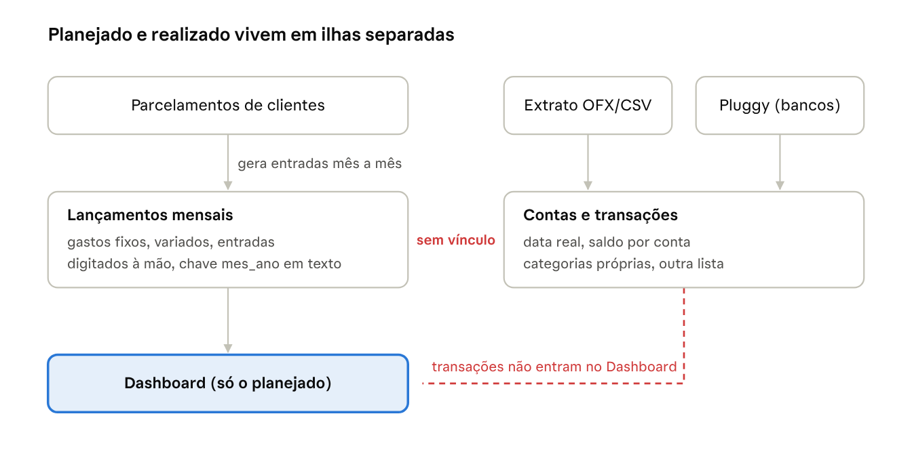
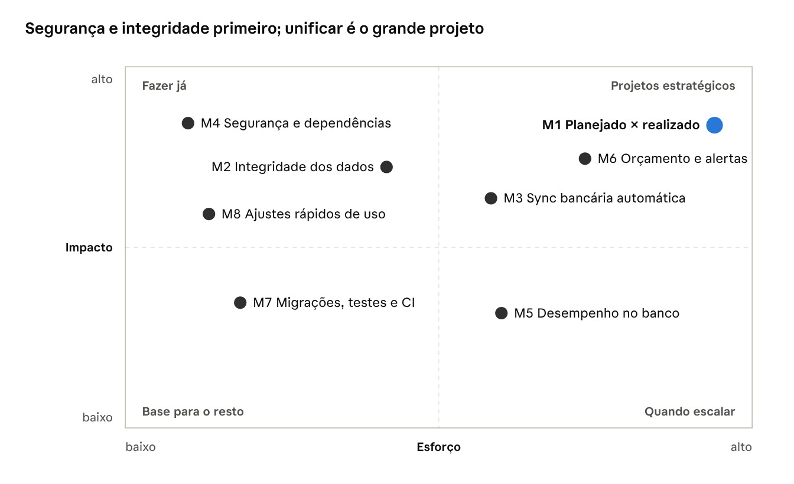
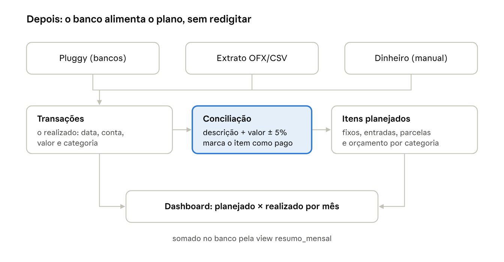
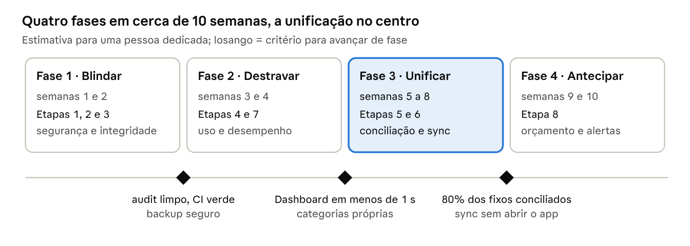

# AppFinanceiro — Análise da Plataforma e Plano de Melhorias

_Análise de 23/11/2026_

## Resumo executivo

O maior ganho está em juntar os dois "mundos" do app: hoje o planejamento mensal (Lançamentos) e o dinheiro real (Contas, extratos e Pluggy) não conversam, e o Dashboard ignora todas as transações bancárias. Logo atrás vêm a proteção contra perda de dados e a sincronização bancária automática, sem depender de abrir a tela.

O app tem uma base boa: ~6.600 linhas em Next.js 14 + Supabase, TypeScript sem erros, lint limpo, RLS em todas as tabelas, PWA instalável e integração Open Finance já funcionando. Os problemas estão na arquitetura de dados, na falta de testes e em dependências com falhas de segurança conhecidas.

| # | Melhoria | Por que importa | Esforço |
| --- | --- | --- | --- |
| 1 | Unificar planejado × realizado (conciliação) | Fim da digitação dupla; Dashboard passa a refletir o banco | Alto |
| 2 | Integridade dos dados (RPCs transacionais, erros visíveis, backup seguro) | Restaurar backup hoje pode apagar tudo se falhar no meio | Médio |
| 3 | Sincronização bancária em segundo plano (webhook + cron) | Dados atualizados sem abrir o app; sem limite de 60 s | Médio |
| 4 | Segurança: atualizar Next.js, trocar xlsx, corrigir redirect e convites | 1 falha crítica e 4 altas no `npm audit` | Baixo |
| 5 | Desempenho: agregar no banco, não no navegador | Dashboard baixa todas as linhas de todos os meses | Médio |
| 6 | Orçamento, recorrências e alertas | Transforma registro em controle ativo | Médio |
| 7 | Fundação de engenharia: migrações, testes, CI | Mudanças seguras e repetíveis | Médio |

## Visão geral da plataforma

É um app web instalável (PWA) de finanças pessoais e familiares, com o navegador falando direto com o Supabase e o servidor Next.js usado só para a Pluggy. Histórico: 23 commits, entregue em fases (redesign, parcelamentos, PWA, família/contas, Open Finance).

| Camada | Tecnologia | Observação |
| --- | --- | --- |
| Front-end | Next.js 14.2 (App Router), React 18, Tailwind, lucide-react | Todas as telas são client components com hooks próprios |
| Dados e login | Supabase (Postgres + Auth + RLS) | Acesso direto do navegador com a chave anon |
| Open Finance | Pluggy SDK + widget `react-pluggy-connect` | 4 rotas em `src/app/api/pluggy` |
| Exportação | `xlsx` 0.18.5 (Excel) e JSON | Gerado no navegador |
| Banco | 3 scripts SQL rodados à mão no SQL Editor | Sem migrações versionadas |

| Tela | O que faz | Tabelas |
| --- | --- | --- |
| Lançamentos | Orçamento do mês: gastos fixos (copiados do mês anterior), variados, entradas e movimentações da reserva | `gastos_fixos`, `gastos_variados`, `entradas`, `movimentacoes` |
| Parcelamentos | Recebimentos parcelados de clientes; gera uma entrada por mês | `parcelamentos` → `entradas` |
| Contas | Saldos, transações com data, importação OFX/CSV com categorização automática, bancos conectados | `contas`, `transacoes`, `pluggy_itens` |
| Dashboard | Receita × gasto por mês, categorias, acumulado | só as tabelas de Lançamentos |
| Configurações | Família (código de convite), tema, backup, exportar, apagar tudo | `familias`, `familia_membros` |



O mesmo gasto (ex.: a conta de luz) precisa ser digitado em Lançamentos mesmo que já tenha chegado pelo banco, e o Dashboard nunca mostra o que de fato saiu da conta.

## Diagnóstico

Foram encontrados 15 problemas: 3 críticos, 5 altos, 6 médios e 1 baixo. Os críticos são o Dashboard cego às transações, o Next.js vulnerável e o restaurar backup que pode apagar tudo. TypeScript e ESLint passam sem erros.

**O que já está bom e deve ser preservado**

- RLS em todas as tabelas, com compartilhamento por família via funções `SECURITY DEFINER` bem isoladas.
- Segredo da Pluggy só no servidor; cada conexão é conferida contra o `clientUserId` do usuário logado.
- Importação OFX/CSV robusta (UTF-8/Windows-1252, vários formatos de data e valor) e sem duplicar, graças ao índice único `(conta_id, external_id)`.
- Categorização que aprende com o histórico da família antes de cair nas regras por palavra-chave.
- PWA instalável, modo escuro, desfazer exclusão, esqueletos de carregamento.

| # | Área | Problema | Onde | Severidade |
| --- | --- | --- | --- | --- |
| 1 | Dados | Dashboard lê só as tabelas de Lançamentos; nada do que veio do banco ou de extratos aparece. O mesmo gasto é digitado duas vezes | `src/hooks/useDashboard.ts:53` | Crítica |
| 2 | Segurança | Next.js 14.2.35 com 1 falha crítica e várias altas (DoS em Server Components, cache poisoning, SSRF) | `npm audit` | Crítica |
| 3 | Integridade | Restaurar backup apaga todos os dados antes de inserir; um erro no meio deixa a conta vazia | `src/hooks/useExportImport.ts:163` | Crítica |
| 4 | Integridade | Criar, salvar e excluir em Lançamentos ignoram o erro do Supabase: a tela mostra salvo, o banco não | `src/hooks/useLancamento.ts:44-55` | Alta |
| 5 | Integridade | Gerar parcelas faz até 2 chamadas por parcela, em série, do navegador e sem transação; fechar a aba deixa o parcelamento pela metade | `src/hooks/useParcelamentos.ts:51` | Alta |
| 6 | Integridade | Gastos fixos do mês podem ser semeados em dobro (duas abas, dois membros da família); não há trava no banco | `src/hooks/useLancamento.ts:103` | Alta |
| 7 | Segurança | `xlsx` 0.18.5 tem falhas altas (prototype pollution, ReDoS) e não recebe correção no npm | `package.json` | Alta |
| 8 | Open Finance | Sincroniza só com a tela Contas aberta; rotas limitadas a 60 s e o 1º sync busca 365 dias de todas as contas em série, podendo estourar o tempo | `src/hooks/usePluggy.ts:26`, `src/app/api/pluggy/sync/route.ts:5` | Alta |
| 9 | Desempenho | Dashboard e exportação baixam todas as linhas de todos os meses e somam no navegador; o saldo da conta é recalculado lendo transação por transação | `src/hooks/useDashboard.ts:53`, `src/lib/pluggy/server.ts:83` | Média |
| 10 | Segurança | O parâmetro `next` do retorno de login não é validado: `next=@site.com` vira redirecionamento para fora do app | `src/app/auth/callback/route.ts:7` | Média |
| 11 | Segurança | Convite de família com 8 caracteres hex, sem expiração nem aprovação; quem entra pode ler e apagar tudo | `supabase/fase1_familia_contas.sql:84` | Média |
| 12 | Modelo de dados | `mes_ano` em texto "MM-YYYY" (não ordena), status sem `CHECK`, duas listas de categorias diferentes | `supabase/schema.sql`, `src/lib/constants.ts:6,56` | Média |
| 13 | Experiência | Sem "esqueci minha senha", sem busca de transações, categorias fixas no código (incluindo itens de uso pessoal, como OAB) | `src/app/(auth)/login/page.tsx` | Média |
| 14 | Engenharia | Zero testes, sem CI, SQL rodado à mão no painel, README padrão do create-next-app | repositório | Média |
| 15 | Experiência | Digitar "1.500" num campo de valor grava R$ 1,50 | `src/lib/utils.ts:35` | Baixa |

## Melhorias propostas

São 8 melhorias. A ordem recomendada é: fechar as brechas de segurança (M4), montar a base de engenharia (M7), eliminar perda de dados e atritos de uso (M2, M8) e então atacar a unificação planejado × realizado (M1), que é a mudança de maior valor e depende das outras para ser feita com segurança.



| Melhoria | O que muda para quem usa |
| --- | --- |
| M1 Planejado × realizado | Cada transação do banco "baixa" o item planejado correspondente; Dashboard mostra orçado × gasto real sem redigitar nada |
| M2 Integridade dos dados | Nada some sem aviso: erros aparecem na tela, parcelamentos e backup são tudo-ou-nada |
| M3 Sync bancária automática | Saldos e transações chegam sozinhos, mesmo sem abrir o app |
| M4 Segurança e dependências | Sem falhas conhecidas; convites de família expiram e precisam de aprovação |
| M5 Desempenho no banco | Dashboard abre rápido mesmo com anos de histórico |
| M6 Orçamento e alertas | Limite por categoria, contas a vencer e aviso no celular antes de estourar |
| M7 Migrações, testes e CI | Atualizações sem quebrar o que funciona; banco recriável com um comando |
| M8 Ajustes rápidos de uso | Recuperar senha, buscar transações, criar categorias próprias, valor digitado sem pegadinha |

## Plano de implementação passo a passo

As etapas estão na ordem de execução: cada uma deixa o terreno pronto para a seguinte. Toda mudança de banco entra como migração versionada (Etapa 2) e vai para um branch do Supabase antes da produção.

### Etapa 1 — Segurança e dependências (M4)

1. **Atualizar o Next.js.** Rode `npx @next/codemod@latest upgrade latest` num branch. O codemod ajusta a maior parte; revise manualmente:
   1. `src/app/api/pluggy/itens/[id]/route.ts`: `params` passa a ser `Promise` — use `const { id } = await params`.
   2. React 19 vem junto; `react-pluggy-connect` precisa ser testado no widget real.
   3. Leia as notas de versão do salto (ex.: no Next 16 o `middleware.ts` passa a se chamar `proxy.ts`).
   4. Rode `npm run build` e teste login, Lançamentos e conectar banco antes do merge.
2. **Trocar o `xlsx`.** Use `exceljs` (mantido no npm) e carregue só ao clicar em Exportar: `const ExcelJS = (await import("exceljs")).default`. Isso também tira ~400 KB do pacote inicial.
3. **Corrigir o resto do audit:** `npm audit fix` (nanoid, postcss, source-map-js). Meta: `npm audit --omit=dev` sem achados altos ou críticos.
4. **Validar o redirecionamento** em `src/app/auth/callback/route.ts`:

   ```ts
   const raw = searchParams.get("next") ?? "/lancamento";
   const next = /^\/(?![\/\\])/.test(raw) ? raw : "/lancamento"; // só caminhos internos
   ```

5. **Endurecer o convite de família** (migração nova):
   1. Código de 12 caracteres a partir de `gen_random_bytes(9)` em base32 e coluna `codigo_expira_em TIMESTAMPTZ DEFAULT now() + interval '48 hours'`; `entrar_familia` recusa código vencido.
   2. Coluna `aprovado BOOLEAN DEFAULT false` em `familia_membros`; `ids_da_familia()` passa a considerar só membros aprovados; nova função `aprovar_membro(p_user UUID)` chamada por quem já está na família.
   3. Na tela de Família, mostrar "Ana quer entrar — Aprovar / Recusar".
6. **Cabeçalhos de segurança** em `next.config.mjs` via `headers()`: `Content-Security-Policy` (liberando Supabase e Pluggy), `X-Frame-Options: DENY`, `Referrer-Policy: strict-origin-when-cross-origin`, `Permissions-Policy`.
7. **No painel do Supabase (Auth):** ativar proteção contra senhas vazadas, senha mínima de 8 caracteres e, opcionalmente, MFA por app autenticador — é um app com dados bancários.

**Pronto quando:** audit limpo, `?next=@exemplo.com` cai em `/lancamento`, convite vencido é recusado.

### Etapa 2 — Migrações, tipos, testes e CI (M7)

1. **Migrações versionadas com a Supabase CLI.**
   1. `npx supabase init` e `npx supabase link --project-ref <ref>`.
   2. `npx supabase db pull` gera a migração-base com o estado atual (equivale aos 3 scripts de hoje). Mova `schema.sql`, `fase1_*.sql` e `fase2_*.sql` para `supabase/legacy/` só como referência.
   3. Toda mudança nova: `npx supabase migration new <nome>`, teste local com `npx supabase start` + `npx supabase db reset`, depois `npx supabase db push`.
   4. Use branches do Supabase (ou um projeto de homologação) para testar migrações antes da produção.
2. **Tipos gerados do banco.** `npx supabase gen types typescript --linked > src/types/database.ts` e `createBrowserClient<Database>(...)`. Isso elimina os `as never` e `as unknown as` espalhados pelos hooks e pega erro de coluna em tempo de compilação. Adicione o comando como script `npm run db:types`.
3. **Testes unitários com Vitest** (`npm i -D vitest`). Comece pelas funções puras, que concentram as regras de dinheiro:
   1. `src/lib/importacao.ts`: `parseValor`, `parseData`, leitura de OFX e CSV com arquivos reais de bancos (anonimizados) em `tests/fixtures/`.
   2. `src/lib/categorizacao.ts`: `chaveDescricao` e `sugerirCategoria`.
   3. `src/lib/utils.ts` (`parseBrl`, `addMonths`) e `installmentValues` (a soma das parcelas tem de bater com o total).
4. **Testes de RLS** com `npx supabase test db` (pgTAP): usuário A não vê dados de B; membro de família vê; membro não aprovado não vê.
5. **Teste ponta a ponta com Playwright**: login → criar lançamento → ver no Dashboard; importar um OFX de exemplo.
6. **CI no GitHub Actions** (`.github/workflows/ci.yml`) em todo PR:

   ```yaml
   name: CI
   on: [pull_request]
   jobs:
     check:
       runs-on: ubuntu-latest
       steps:
         - uses: actions/checkout@v4
         - uses: actions/setup-node@v4
           with: { node-version: 22, cache: npm }
         - run: npm ci
         - run: npm run lint
         - run: npx tsc --noEmit
         - run: npx vitest run
         - run: npm run build
         - run: npm audit --omit=dev --audit-level=high
   ```

7. **Dependabot** (`.github/dependabot.yml`) semanal para npm, e proteção do branch `main` exigindo o CI verde.
8. **Observabilidade:** `error.tsx` em `src/app/(app)/` para não mostrar tela branca, e Sentry (ou os logs da Vercel) para erros do navegador e das rotas da Pluggy.
9. **README real:** o que o app faz, variáveis de ambiente, como subir o banco local e rodar os testes.

**Pronto quando:** um PR com teste quebrado não consegue ser mesclado e `supabase db reset` recria o banco do zero.

### Etapa 3 — Integridade dos dados (M2)

Regra geral: toda operação que mexe em mais de uma linha vira uma função no banco (RPC), que roda numa transação única — ou grava tudo, ou nada. As funções usam `SECURITY INVOKER`, então o RLS da família continua valendo.

1. **Erros visíveis em Lançamentos.** Em `makeTable` (`src/hooks/useLancamento.ts`), conferir o `error` de cada chamada, desfazer a atualização otimista e avisar:

   ```ts
   async save(id, patch) {
     const antes = rows.find(r => r.id === id);
     setRows(prev => prev.map(r => (r.id === id ? { ...r, ...patch } : r)));
     const { error } = await supabase.from(name).update(patch).eq("id", id);
     if (error) {
       if (antes) setRows(prev => prev.map(r => (r.id === id ? antes : r)));
       throw new Error(error.message); // a tela mostra o toast
     }
     if (afterSave) await afterSave(antes, patch);
   }
   ```

   Faça o mesmo em `create`, `remove` e `restore`, e nos hooks de Parcelamentos e Exportação.

2. **Parcelamentos em uma chamada só.** Criar índice único `entradas(parcelamento_id, parcela_num)` e a função `sincronizar_parcelas(p_id UUID)`, que faz em uma transação o que hoje é um laço no navegador:

   ```sql
   CREATE OR REPLACE FUNCTION public.sincronizar_parcelas(p_id UUID)
   RETURNS VOID LANGUAGE plpgsql SECURITY INVOKER AS $$
   DECLARE p parcelamentos; total_c BIGINT; base_c BIGINT;
   BEGIN
     SELECT * INTO p FROM parcelamentos WHERE id = p_id FOR UPDATE;
     IF NOT FOUND THEN RAISE EXCEPTION 'Parcelamento não encontrado'; END IF;
     total_c := round(p.valor_total * 100);
     base_c  := total_c / p.num_parcelas;
     INSERT INTO entradas (user_id, parcelamento_id, parcela_num, mes_ano, "desc",
                           tipo, valor, parcela, recebido, ordem)
     SELECT p.user_id, p.id, n,
            to_char(to_date(p.mes_inicial, 'MM-YYYY') + (n - 1) * interval '1 month', 'MM-YYYY'),
            p.cliente || coalesce(' — ' || nullif(trim(p."desc"), ''), ''),
            'Parcelamento cliente',
            (base_c + CASE WHEN n = p.num_parcelas THEN total_c - base_c * p.num_parcelas ELSE 0 END) / 100.0,
            n || '/' || p.num_parcelas,
            CASE WHEN n <= p.parcelas_pagas THEN 'OK' ELSE 'Pendente' END,
            100 + n
       FROM generate_series(1, p.num_parcelas) n
     ON CONFLICT (parcelamento_id, parcela_num) DO UPDATE
       SET mes_ano = EXCLUDED.mes_ano, "desc" = EXCLUDED."desc",
           valor = EXCLUDED.valor, parcela = EXCLUDED.parcela; -- preserva "recebido"
     -- Parcelas além do novo total: apaga as pendentes, destaca as recebidas.
     DELETE FROM entradas WHERE parcelamento_id = p.id AND parcela_num > p.num_parcelas AND recebido <> 'OK';
     UPDATE entradas SET parcelamento_id = NULL, parcela_num = NULL
      WHERE parcelamento_id = p.id AND parcela_num > p.num_parcelas;
   END $$;
   ```

   No hook, `syncEntradas` passa a ser `await supabase.rpc("sincronizar_parcelas", { p_id })`. Faça o mesmo para excluir o parcelamento. O progresso (`parcelas_pagas`) pode virar um *trigger* em `entradas`, eliminando `syncParcelamentoProgress`.

3. **Gastos fixos sem duplicar.** Mover `seedFixos` para a função `semear_gastos_fixos(p_mes TEXT)`, que começa com `PERFORM pg_advisory_xact_lock(hashtext(coalesce(minha_familia_id(), auth.uid())::text || p_mes))` e só insere se o mês ainda estiver vazio para a família. Duas abas ou dois membros ao mesmo tempo passam a gerar uma única cópia.
4. **Backup que não apaga antes da hora.**
   1. Validar o arquivo no navegador com `zod` (versão, campos, tipos) antes de qualquer escrita.
   2. Baixar automaticamente um backup do estado atual antes de restaurar.
   3. Fazer a troca na função `restaurar_backup(p JSONB)`: apaga os dados do usuário e insere com `jsonb_populate_recordset` na mesma transação. Qualquer erro desfaz tudo e os dados antigos continuam lá.
   4. "Apagar tudo" vira `apagar_meus_dados()`, também transacional e com erro visível.
5. **Restrições no banco** para o que hoje só o TypeScript garante: `CHECK (pago IN ('OK','Pendente','Não pagou'))`, o mesmo para `recebido` e `situacao`, `CHECK (num_parcelas >= 1)` e `CHECK (parcelas_pagas BETWEEN 0 AND num_parcelas)`. Crie com `NOT VALID` e depois `VALIDATE CONSTRAINT` para não travar a tabela.

**Pronto quando:** derrubar a rede no meio de "salvar" mostra erro e volta o valor antigo; restaurar um backup corrompido não muda nada.

### Etapa 4 — Ajustes rápidos de uso (M8)

1. **Recuperar senha.**
   1. Link "Esqueci minha senha" em `src/app/(auth)/login/page.tsx` abrindo `/recuperar`, que chama `supabase.auth.resetPasswordForEmail(email, { redirectTo })`, com `redirectTo` = origem do site + `/auth/callback?next=/nova-senha`.
   2. Página `/nova-senha` com `supabase.auth.updateUser({ password })`.
   3. Incluir `/recuperar` na lista de rotas públicas de `src/lib/supabase/middleware.ts`.
2. **Valor digitado sem pegadinha.** Em `parseBrl` (`src/lib/utils.ts`), tratar ponto seguido de exatamente 3 dígitos como milhar, e fazer o mesmo em `parseValor` da importação:

   ```ts
   if (/^\d{1,3}(\.\d{3})+$/.test(cleaned)) cleaned = cleaned.replace(/\./g, ""); // "1.500" → 1500
   ```

   Troque também `brl()` por `new Intl.NumberFormat("pt-BR", { style: "currency", currency: "BRL" })`, que trata negativos e arredondamento de forma padrão. Cubra os dois com os testes da Etapa 2.

3. **Busca e filtros de transações.** Campo de busca na tela Contas que consulta todos os meses com `.ilike("descricao", "%termo%")`, mais filtros por categoria, conta, faixa de valor e período. No banco, `CREATE EXTENSION pg_trgm` e índice `GIN (descricao gin_trgm_ops)` para a busca continuar rápida.
4. **Categorias próprias, numa lista só.**
   1. Tabela `categorias (id, dono, nome, tipo ['gasto','receita','transferencia'], cor, icone, ordem, arquivada)`, com o mesmo RLS da família, semeada a partir de `CATS_FIXOS`, `CATS_VAR` e `CATS_TRANSACAO`.
   2. Tela em Configurações para criar, renomear, arquivar e reordenar. Renomear atualiza os lançamentos e transações existentes.
   3. Os seletores de categoria passam a ler dessa tabela. Itens hoje fixos no código, como OAB e honorários, viram dados do usuário.
5. **Regras de categorização do usuário.** Ao trocar a categoria de uma transação, perguntar "Aplicar a outras 12 parecidas e às próximas?". Gravar em `regras_categoria (padrao, categoria)`, que `sugerirCategoria` consulta antes do histórico e das regras fixas.
6. **Edição em massa:** selecionar várias transações e mudar categoria, conta ou marcar como transferência de uma vez.
7. **Primeiro acesso guiado:** uma tela de boas-vindas com 3 passos (criar conta, conectar banco ou importar extrato, revisar gastos fixos), em vez de abrir direto num mês vazio.

**Pronto quando:** "1.500" grava R$ 1.500,00 e o usuário cria uma categoria sem mexer no código.

### Etapa 5 — Unificar planejado × realizado (M1)

Lançamentos passa a ser o **plano** do mês e as transações, o **realizado**. Cada transação que chega do banco é ligada ao item planejado correspondente, que fica pago sozinho. Depende das Etapas 2 a 4 (migrações, RPCs e categorias únicas).



1. **Competência como data.** Adicionar `competencia DATE` (1º dia do mês) em `gastos_fixos`, `gastos_variados`, `entradas` e `movimentacoes`, preencher com `UPDATE ... SET competencia = to_date(mes_ano, 'MM-YYYY')`, criar índice `(user_id, competencia)` e trocar o app para usar a nova coluna. Remover `mes_ano` só depois de duas versões estáveis.
2. **Vínculo transação → item.** Em `transacoes`, colunas `gasto_fixo_id` e `entrada_id` (FK com `ON DELETE SET NULL`) e `CHECK (num_nonnulls(gasto_fixo_id, entrada_id) <= 1)`. Um *trigger* marca o item como `OK` ao vincular (e preenche o valor se o item estiver zerado) e volta para `Pendente` ao desvincular.
3. **Sugestão automática.** Função `sugerir_conciliacao(p_competencia DATE)` que devolve pares transação → item com uma nota. Critérios:
   1. mesmo mês (com folga de 5 dias nas bordas, para vencimentos);
   2. mesmo sentido (saída ↔ gasto, entrada ↔ entrada);
   3. valor dentro de 5% ou R$ 5;
   4. descrição parecida (`similarity()` do `pg_trgm` ≥ 0,3) ou uma regra já confirmada antes ("ENEL" → "Energia elétrica"), guardada em `regras_conciliacao`.
4. **Tela de Lançamentos.** Cada gasto fixo mostra "pago via Nubank em 05/11" ou "sugestão: ENEL R$ 187,30 — Confirmar". Um botão "Confirmar todas" aceita as sugestões de nota alta.
5. **Gastos variados viram calculados:** são as saídas do mês que não foram ligadas a um gasto fixo, agrupadas por categoria e sem `Transferência`. Quem paga algo em espécie usa a conta "Dinheiro" (tipo `carteira`, que já existe). A digitação manual de variados deixa de ser necessária.
6. **Entradas e parcelamentos:** o PIX recebido do cliente é conciliado com a parcela do mês, que fica `recebido = OK` e atualiza o progresso do parcelamento (trigger da Etapa 3).
7. **Dashboard sobre uma view.** Criar `resumo_mensal` (`security_invoker = true`) que soma, por competência e categoria, o planejado (itens) e o realizado (transações sem `Transferência`). O pagamento da fatura do cartão já é categorizado como transferência, então a compra no cartão não é contada duas vezes. O Dashboard passa a mostrar planejado × realizado, % do orçamento usado e saldo real das contas.
8. **Lançamento gradual.** Uma opção "Conciliação com o banco" em Configurações, ligada primeiro só para a sua família. Rodar `sugerir_conciliacao` nos 3 meses anteriores e confirmar em lote. Comparar os totais antigos e novos por 1 a 2 meses antes de tornar o padrão.

**Pronto quando:** num mês típico, ≥ 80% dos gastos fixos são conciliados sem digitação e o Dashboard bate com o saldo dos bancos.

### Etapa 6 — Sincronização bancária em segundo plano (M3)

Hoje a sincronização só acontece quando alguém abre a tela Contas, e cada chamada tem 60 s para trazer tudo. A ideia é a Pluggy avisar o app e um processo no servidor buscar os dados em partes pequenas.

1. **Cliente administrativo só no servidor.** `src/lib/supabase/admin.ts` com `SUPABASE_SERVICE_ROLE_KEY` (sem `NEXT_PUBLIC_`, com `import "server-only"`). Como ele ignora o RLS, toda consulta nele filtra explicitamente pelo `user_id` da linha de `pluggy_itens`.
2. **Fila de sincronização.** Tabela `sync_jobs (id, pluggy_item_id, motivo, status ['pendente','rodando','ok','erro'], tentativas, proxima_tentativa, erro, criado_em)`, sem acesso pelo navegador (RLS sem políticas).
3. **Webhook da Pluggy** em `src/app/api/pluggy/webhook/route.ts`:
   1. Registrar a URL para os eventos `item/updated`, `item/error`, `transactions/created` e `transactions/updated` (pelo painel da Pluggy ou pelo SDK).
   2. Proteger com um segredo no cabeçalho configurado no registro e conferir no handler. Nunca confiar no corpo: usar só o `itemId` e buscar o item na API.
   3. O handler apenas insere um job e responde 200 em milissegundos.
4. **Processador da fila** em `src/app/api/cron/sync/route.ts`, chamado pelo Vercel Cron a cada 10 minutos (`vercel.json` → `crons`) e protegido por `CRON_SECRET`. Ele pega os jobs pendentes com `FOR UPDATE SKIP LOCKED`, roda o `sincronizarItem` atual com o cliente admin e reagenda falhas com espera crescente (1, 5, 30 min).
5. **Primeira carga em fatias.** Em vez de 365 dias de uma vez, buscar 90 dias por job e enfileirar o próximo período até cobrir o ano. Nenhuma chamada chega perto do limite de tempo.
6. **Saldo calculado no banco.** Trocar o laço `somaTransacoes` (que lê transação por transação) por uma função `ajustar_saldo(p_conta UUID, p_saldo NUMERIC, p_ate DATE)` que faz `SUM` em SQL e atualiza `saldo_inicial` numa única chamada — usada pela Pluggy e pela importação.
7. **Tela sempre atualizada.** Assinar o Supabase Realtime em `transacoes` e `pluggy_itens` na tela Contas para recarregar quando chegar algo novo; mostrar "atualizado há 12 min" por banco. Manter o botão "Sincronizar agora", que passa a só enfileirar um job.
8. **Conexões com problema:** quando o item ficar em `LOGIN_ERROR` ou `WAITING_USER_ACTION`, gerar um alerta (Etapa 8) com o botão "Reconectar".

**Pronto quando:** uma compra feita no cartão aparece no app logo depois que a Pluggy atualiza o banco, sem ninguém abri-lo, e o primeiro sync de um banco com muitas contas não falha por tempo.

### Etapa 7 — Desempenho (M5)

1. **Dashboard agregado no banco.** Antes mesmo da Etapa 5, criar a função `resumo_dashboard(p_de DATE, p_ate DATE)` com `SUM ... GROUP BY competencia, categoria` sobre as tabelas atuais. O navegador passa a receber dezenas de linhas (meses × categorias) em vez de todas as linhas de todos os meses. Depois da Etapa 5, ela lê de `resumo_mensal`.
2. **Cache de dados com TanStack Query.** Envolver os hooks (`useLancamento`, `useContas`, `useDashboard`, `useParcelamentos`) em `useQuery`/`useMutation`: evita recarregar ao trocar de tela, junta chamadas repetidas e já traz atualização otimista com desfazer em caso de erro (reforça a Etapa 3).
3. **Pacote inicial menor.** `next/dynamic` para o widget da Pluggy, os gráficos e a exportação; medir antes e depois com `@next/bundle-analyzer`.
4. **Listas longas:** paginação ou virtualização (`@tanstack/react-virtual`) na lista de transações do mês.
5. **Exportação por período:** escolher ano ou intervalo em vez de baixar o histórico inteiro para montar o Excel.
6. **Revisão do banco:** rodar os *advisors* de desempenho e segurança do Supabase e `EXPLAIN ANALYZE` nas consultas mais usadas; criar índices só onde o plano pedir.

**Pronto quando:** o Dashboard abre em menos de 1 s com 5 anos de dados e o Lighthouse mobile fica ≥ 90.

### Etapa 8 — Orçamento, vencimentos e alertas (M6)

1. **Orçamento por categoria.** Tabela `orcamentos (dono, categoria_id, valor_mensal, a_partir_de)`. Em Lançamentos e no Dashboard, barras como "Mercado: R$ 1.240 de R$ 1.500 (83%)", com o gasto real vindo das transações.
2. **Vencimentos.** Coluna `dia_vencimento SMALLINT` em `gastos_fixos` (copiada ao semear o mês). No topo de Lançamentos, "Vence nos próximos 7 dias"; o que já foi conciliado sai da lista sozinho.
3. **Projeção do mês:** saldo previsto no fim do mês = saldo atual das contas + entradas pendentes − gastos fixos pendentes.
4. **Notificações no celular (PWA).**
   1. *Service worker* em `public/sw.js` e Web Push com chaves VAPID (`web-push` no servidor).
   2. Tabela `push_inscricoes (user_id, endpoint, p256dh, auth)` e um botão "Ativar avisos" em Configurações.
   3. No iPhone só funciona com o app adicionado à Tela de Início (iOS 16.4 ou superior); explicar isso na própria tela.
5. **Rotina diária de alertas** (mesmo Vercel Cron da Etapa 6): conta vence amanhã; categoria passou de 80% ou 100%; banco precisa reconectar; parcela de cliente atrasada.
6. **Central de alertas no app** (ícone de sino) para quem não ativar push.
7. **Resumo do mês no dia 1:** "Outubro: R$ 8.420 gastos, 94% do planejado, R$ 1.100 guardados."
8. **Meta de reserva:** usar `movimentacoes` para acompanhar uma meta (ex.: 6× a média dos gastos fixos), com barra de progresso.

**Pronto quando:** o usuário recebe o aviso de uma conta antes do vencimento e vê quanto ainda pode gastar em cada categoria.

## Roadmap e métricas de sucesso

O plano cabe em cerca de 10 semanas para uma pessoa, em 4 fases; a fase 1 pode começar já e elimina os 3 riscos críticos nas duas primeiras semanas. Cada fase só avança quando o critério no losango for atingido.



| Métrica | Hoje | Meta | Como medir |
| --- | --- | --- | --- |
| Pacotes com falha alta ou crítica | 5 (next, xlsx, nanoid, postcss, source-map-js) | 0 | `npm audit` no CI |
| Cobertura de testes em `src/lib` | 0% | ≥ 80% | `vitest --coverage` |
| Gastos fixos conciliados sem digitação | 0% | ≥ 80% | transações com `gasto_fixo_id` no mês |
| Lançamentos digitados à mão por mês | não medido | −70% | contagem de linhas manuais por competência |
| Quando o dado do banco aparece | só ao abrir a tela Contas | logo após a atualização da Pluggy | `ultima_sync` × `lastUpdatedAt` |
| Carga do Dashboard com 5 anos de dados | não medido; cresce com o histórico | < 1 s | Vercel Speed Insights |
| Erros de gravação que o usuário não vê | não medido | 0 | Sentry + toasts de erro |

**Próximo passo:** abrir um branch para a Etapa 1 (atualizar Next.js e trocar `xlsx`) e configurar o CI da Etapa 2 no mesmo PR, para que tudo que vier depois já passe pelos testes.
